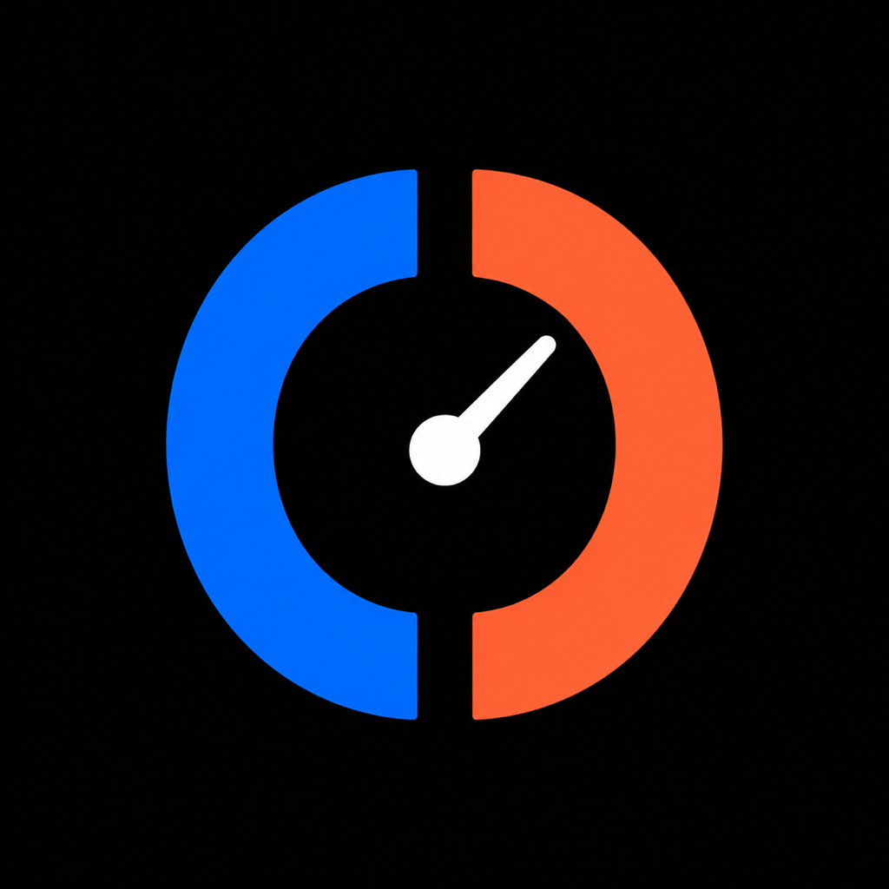

# Codex and Claude Notch Dashboard



A native macOS utility that turns the display notch into a compact agent-capacity
dashboard. Its idle surface contracts to the physical camera-notch width so it
does not occupy either native menu-bar wing. Hover over the notch to reveal the
selected provider's exact monochrome logo on the left and its remaining
percentage on the right. The counters remain visible for two seconds after the
pointer leaves; click the notch or either revealed wing to open both signals
side by side.

- Remaining weekly Codex usage and its reset time.
- Remaining Claude Code five-hour allowance and its reset time.

The app is an `LSUIElement`: it has no Dock icon and creates no legacy status
item. The expanded footer lets you choose whether Codex or Claude Code appears
in the compact state and pin the counters when you want them to remain visible.
Pinning intentionally keeps the side counters in the menu bar, so leave it off
on crowded menu bars or when a menu-bar organizer such as Ice needs that space.
Both providers remain visible in the expanded two-pane dashboard. Click
outside, press Escape, or use the Close button to collapse it. Closing returns
to the compact counters for two seconds before the idle surface contracts. The
connected surface is always black, matching the physical notch without a
separate light/dark appearance toggle.

On a Mac without a notch, the same compact surface stays centered at the top of
the screen. The initial scope is notch-only—there is no WidgetKit extension.

The Codex and Claude marks use the supplied monochrome PNG assets. The Codex
mark is from [Lobe Icons](https://github.com/lobehub/lobe-icons) and is bundled
under its MIT license. The provider-neutral Agent Usage app icon is original to
this project; the project is not affiliated with or endorsed by OpenAI or
Anthropic.

## Requirements

- macOS 13 or newer
- Codex installed and signed in
- Claude Code with the current status-line rate-limit fields (verified with
  2.1.220)

The downloadable preview does not require Xcode. Building from source requires
Xcode 26.3 because the checked-in project uses the current Xcode project format.

The current bundled Codex executable is discovered automatically at
`/Applications/ChatGPT.app/Contents/Resources/codex`. The resolver also checks
the app registered under bundle identifier `com.openai.codex`, user-level
Applications folders, and common `PATH` locations. For development, an exact
executable can be supplied with `CODEX_USAGE_CODEX_PATH`.

## Install the friend preview

Download `Agent-Usage-0.1.0-preview.3-macos-universal.zip` from the repository's
[Releases](https://github.com/brian890809/codex-usage-menubar/releases), unzip
it, and move **Agent Usage.app** to `/Applications`.

The friend preview is ad-hoc signed rather than notarized. On its first launch,
macOS may block it. Try to open the app once, then go to **System Settings →
Privacy & Security** and choose **Open Anyway**. Only use this override for a
preview downloaded from this repository. A future Developer ID release will
open through the normal Gatekeeper flow.

This repository is currently private, so testers must first be added as
collaborators. Share suggestions and bugs through the repository's
[Issues](https://github.com/brian890809/codex-usage-menubar/issues/new/choose)
using the friend preview feedback form.

## Build and open from source

Open `CodexUsageMenuBar.xcodeproj` in Xcode, select the **CodexUsageMenuBar**
scheme and **My Mac**, then Run. Hover over the notch to reveal the compact
counters, or click the idle notch to open the dashboard directly. The idle
notch is also exposed to VoiceOver as **Open usage dashboard**; reopening the
running app from Spotlight provides a keyboard-only way to expand it.

The same build can be produced from Terminal:

```sh
xcodebuild \
  -project CodexUsageMenuBar.xcodeproj \
  -scheme CodexUsageMenuBar \
  -configuration Debug \
  -destination 'platform=macOS' \
  -derivedDataPath .build/FinalDerivedData \
  CODE_SIGNING_ALLOWED=NO \
  build

open .build/FinalDerivedData/Build/Products/Debug/CodexUsageMenuBar.app
```

If an older build is already running, quit it from its popup before opening the
new build.

### Preview fixed percentages

To check how the notch renders a specific value (for example the wide `100%`
label) without live data, launch the app with preview arguments:

```sh
.build/FinalDerivedData/Build/Products/Debug/CodexUsageMenuBar.app/Contents/MacOS/CodexUsageMenuBar \
  -PreviewCodexPercent 100 -PreviewClaudePercent 100
```

Each argument is independent and clamps to 0–100; a provider without one keeps
its live data. In Xcode, add the same arguments under **Product → Scheme →
Edit Scheme… → Run → Arguments** instead.

## Connect Claude Code

Claude Code sends structured usage data to a configured status-line command.
After installing the friend preview, add this entry to
`~/.claude/settings.json`:

```json
{
  "statusLine": {
    "type": "command",
    "command": "/bin/zsh '/Applications/Agent Usage.app/Contents/Resources/ClaudeContextCapture.sh'"
  }
}
```

For a local source build, replace the command with the script at:

```text
.build/FinalDerivedData/Build/Products/Debug/CodexUsageMenuBar.app/Contents/Resources/ClaudeContextCapture.sh
```

Claude Code reloads settings automatically and updates the counter after the
next API response. The `rate_limits` fields are available for Claude.ai Pro and
Max subscribers; when several sessions are running, any of them can refresh the
same account-level allowance.

## Test

Run the deterministic suite with:

```sh
xcodebuild \
  -project CodexUsageMenuBar.xcodeproj \
  -scheme CodexUsageMenuBar \
  -destination 'platform=macOS' \
  -derivedDataPath .build/FinalDerivedData \
  CODE_SIGNING_ALLOWED=NO \
  test
```

The installed-Codex integration check stays opt-in so normal tests do not depend
on a local sign-in. Run it explicitly with:

```sh
xcodebuild \
  -project CodexUsageMenuBar.xcodeproj \
  -scheme CodexUsageMenuBarLive \
  -destination 'platform=macOS' \
  -derivedDataPath .build/FinalDerivedData \
  CODE_SIGNING_ALLOWED=NO \
  -only-testing:CodexUsageMenuBarTests/CodexAppServerAdapterTests/testLiveInstalledCodexWhenRequested \
  test
```

## How Codex usage is read

`CodexAppServerAdapter` launches the resolved executable directly with
`app-server --stdio`, completes the newline-delimited initialization handshake,
and makes one `account/rateLimits/read` request. Each refresh uses a fresh child
process and closes its input after receiving the matching response.

The app decodes only the rate-limit fields it needs. It prefers the `codex`
entry in `rateLimitsByLimitId`, falls back to the legacy `rateLimits` snapshot,
and identifies the weekly window by duration rather than assuming it is always
in `primary` or `secondary`. The app refreshes Codex at launch, again when the
current snapshot is at least one minute old as the dashboard opens, or
immediately when the Refresh button is used.

The adapter does not read Codex configuration, auth files, Keychain items, or
environment credentials. It passes no tokens and stores no raw protocol output.
Codex itself uses the user's existing sign-in. App-server stderr is discarded,
and server errors are reduced to a code before they reach the UI.

The app-server API is experimental, so protocol-specific types, handshake code,
and process handling stay under `CodexUsageMenuBar/AppServer`.

## How Claude usage is read

`ClaudeContextCapture.sh` receives Claude Code's documented status-line JSON on
stdin and reduces it to only the account-level five-hour used percentage, reset
time, and update time. It atomically writes that reduced payload with user-only
permissions under:

```text
~/Library/Caches/com.bchen.CodexUsageMenuBar/claude-usage.json
```

The notch app watches that cache once per second and converts used percentage
to remaining percentage. If a new Claude session has not received its first API
response yet, the bridge preserves the last valid snapshot; expired windows are
not displayed. The bridge uses macOS's built-in `plutil`, so testers do not need
Homebrew or `jq`. It does not invoke Claude, consume model tokens, inspect
transcripts or workspace paths, or read credential files.

## Package a friend preview

Run the deterministic packaging script to build both Apple Silicon and Intel
architectures, apply an ad-hoc signature, and create the ZIP under
`.build/releases`:

```sh
./scripts/package-preview.sh 0.1.0-preview.3
```

The script verifies the app's code-signature seal and both architectures before
creating the archive. This artifact is intended only for trusted preview
testers; a general release should use Developer ID signing and notarization.
